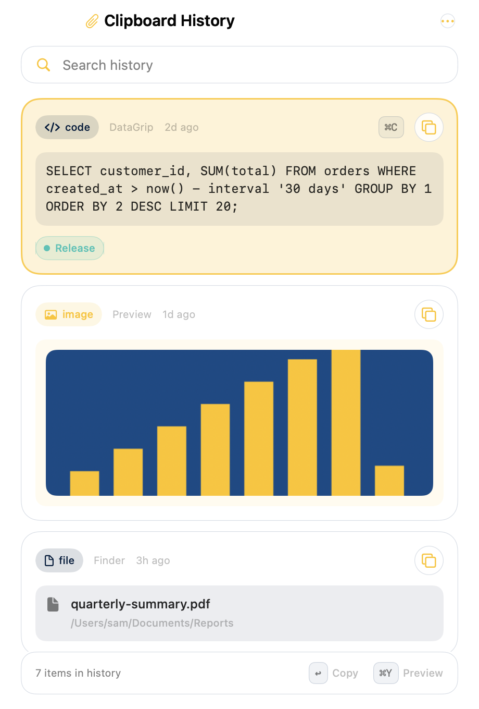
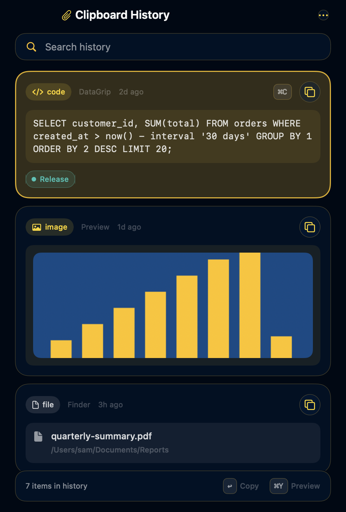
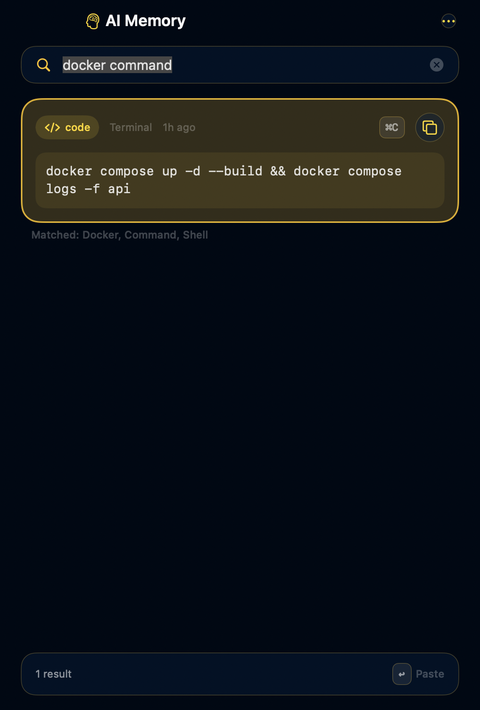

<p align="center">
  
</p>

<h1 align="center">Paperclip</h1>

<p align="center">
  <strong>Everything you copy, one keystroke away.</strong><br />
  A private, keyboard-first clipboard manager for macOS with an optional on-device AI Memory.
</p>

<p align="center">
  <a href="https://github.com/mhadikz/Paperclip/actions/workflows/ci.yml"></a>
  <a href="https://github.com/mhadikz/Paperclip/releases/latest"></a>
  
  
  <a href="LICENSE"></a>
</p>

<p align="center">
  <a href="https://github.com/mhadikz/Paperclip/releases/latest"><b>Download</b></a> ·
  <a href="https://mhadikz.github.io/Paperclip/">Website</a> ·
  <a href="#usage">Usage</a> ·
  <a href="#ai-memory">AI Memory</a> ·
  <a href="#privacy-and-security">Privacy</a> ·
  <a href="#development">Development</a> ·
  <a href="CHANGELOG.md">Changelog</a>
</p>

<p align="center">
  
  
  
</p>
<p align="center"><sub>Opaque “Reduce Transparency” renders; on macOS 26 the panel uses Liquid Glass.</sub></p>

---

Paperclip lives in your menu bar and remembers what you copy: text, links, images and files. Press
<kbd>⇧</kbd><kbd>⌘</kbd><kbd>V</kbd>, pick a clip with the arrow keys, press <kbd>↩</kbd>, and it is
pasted into the app you were working in. Nothing leaves your Mac: there is no account, no server and
no analytics. With Apple Intelligence available, an optional AI Memory layer tags and summarises
clips on-device so you can ask for *“the docker command from last week”*. With AI off, Paperclip is
still a complete clipboard manager.

## Contents

- [Why Paperclip](#why-paperclip)
- [Features](#features)
- [Install](#install)
- [First run and permissions](#first-run-and-permissions)
- [Usage](#usage)
- [AI Memory](#ai-memory)
- [Privacy and security](#privacy-and-security)
- [Settings reference](#settings-reference)
- [Your data](#your-data)
- [Architecture](#architecture)
- [Development](#development)
- [Roadmap and non-goals](#roadmap-and-non-goals)
- [FAQ](#faq)
- [Contributing](#contributing)
- [License](#license)

## Why Paperclip

- **It never gets in the way.** Capturing a copy is synchronous and cheap. AI, OCR, image encoding and
  disk writes all happen afterwards, off the main thread. The menu bar list stays unfiltered while you
  search elsewhere.
- **It pastes where you were.** The History window is a non-activating panel. The app you came from
  keeps focus, so the clip lands there instead of in Paperclip itself.
- **It is honest about privacy.** Likely secrets are skipped before they are stored. Concealed copies
  from password managers are always ignored. Logs never contain clipboard content. The data folder is
  plain JSON you can read, back up or delete.
- **It is a real codebase.** SwiftUI + AppKit, Clean Architecture with dependency injection, 77 fast
  tests, scripted builds that need only the Command Line Tools, and documentation written for the next
  person to touch it.

## Features

**Capture**

- Text, links, images and files, polled every 0.35 s from the system pasteboard.
- Rich text kept as an RTF sidecar (bold, links, colors) and restored on paste; toggleable.
- Identical copies bump the existing clip instead of duplicating it, so pins, favorites and tags
  survive re-copies. Images are deduplicated by SHA-256.
- Text recognition (OCR) on images, on-device, so you can search for words inside a screenshot.
- Spreadsheet and table copies are stored as text, not as an image.
- Oversized copies (over 1,000,000 characters) are left on the system clipboard rather than stored.

**History panel**

- Opens on the screen under the mouse, remembers its size, closes when it loses focus.
- Modes: Clipboard History, AI Memory, Favorites.
- Cards show a type badge, source app, relative time, favorite star, pinboard chips, a bounded
  excerpt and a thumbnail for images.
- Full-size preview for text, code, images and file lists, with details and memory tags.
- Context menu: Paste, Paste as Plain Text, Copy, Preview, Open Link, Reveal in Finder, Favorite,
  Pin to…, Add to Paste Stack, Rename…, Delete.
- Drag clips out into other apps as text, URL, file or image.
- Can hide itself from screen sharing and recordings.

**Paste**

- Paste into the frontmost app (sends ⌘V after writing the pasteboard; needs Accessibility).
- Paste as plain text, paste the next item from a FIFO paste stack, paste transformed AI output
  without adding it to history.
- Quick paste with <kbd>⌘</kbd><kbd>1</kbd>–<kbd>9</kbd> in History and <kbd>⌘</kbd><kbd>0</kbd>–<kbd>9</kbd>
  from the menu bar.

**Organise**

- Pinboards with six legible colors; create, rename, recolor, delete; pin a clip to several boards.
- Favorites. Pinned and favorite clips are never trimmed by the history limit.
- Rename clips. Filter by type. Exclude apps from capture. Pause recording from the menu bar.

**AI Memory (optional)**

- Categories, tags, one-line summaries and related clips, computed on-device.
- Natural-language search in two phases: an instant heuristic pass, then model refinement for
  longer questions.
- Smart actions on a clip: explain, rewrite in a style, format JSON, extract, and more.
- Works without Apple Intelligence through a heuristic provider; the whole layer can be switched off.

**Appearance**

- Light, Dark or System. Liquid Glass on macOS 26 with a material fallback on 14 and 15, and opaque
  surfaces when Reduce Transparency is on. Adjustable glass tint.
- Desktop and Notification Center widget (small, medium, large) with a Copy button per row.
- Menu bar icon shows a badge while recording is paused.

## Install

**Requirements:** macOS 14 Sonoma or later. Apple Silicon and Intel are both supported by one
universal build. Apple Intelligence features need macOS 26 and a Mac that supports it; everything
else works everywhere.

1. Download `Paperclip-<version>.dmg` from the
   [latest release](https://github.com/mhadikz/Paperclip/releases/latest).
2. Open the DMG and drag **Paperclip** into **Applications**.
3. Open it once with **right-click → Open → Open**. Builds are signed but not notarized (no Apple
   Developer Program membership), so macOS warns that the developer cannot be verified. This happens
   once. The Terminal equivalent:

   ```bash
   xattr -d com.apple.quarantine /Applications/Paperclip.app
   ```

**Verify the download.** Every release ships a `SHA256SUMS.txt`:

```bash
shasum -a 256 -c SHA256SUMS.txt
```

**Build it yourself** (only the Command Line Tools are needed):

```bash
git clone https://github.com/mhadikz/Paperclip.git
cd Paperclip
./scripts/build.sh          # builds and installs ~/Applications/Paperclip.app
```

## First run and permissions

The paperclip appears in the menu bar. Press <kbd>⇧</kbd><kbd>⌘</kbd><kbd>V</kbd> to open History.
Paperclip asks for nothing it does not need, and explains each request in Settings:

| Permission | Needed for | Without it |
| --- | --- | --- |
| **Accessibility** | Sending ⌘V to the previous app after you choose a clip | Paperclip copies the clip and you press ⌘V yourself |
| **Login item** | Starting with your Mac (Settings → General → Open at login) | Launch it manually |
| **Apple Intelligence** | Model-based tags, summaries and natural-language search | Heuristic tagging and keyword search |

Paperclip never asks for network access, Full Disk Access, screen recording or your contacts.

## Usage

### Menu bar

Click the paperclip for the ten most recent clips (<kbd>⌘</kbd><kbd>0</kbd>–<kbd>9</kbd> paste them),
paste-stack actions when the stack is not empty, Pause / Resume Recording, Delete All History,
Settings and Quit. The menu list is never filtered by whatever you typed in History search.

### History panel

| Shortcut | Action |
| --- | --- |
| <kbd>⇧</kbd><kbd>⌘</kbd><kbd>V</kbd> | Open or close History (change it in Settings → General) |
| <kbd>↑</kbd> <kbd>↓</kbd> | Move the selection |
| <kbd>↩</kbd> | Paste into the previous app |
| <kbd>⇧</kbd><kbd>↩</kbd> | Paste as plain text |
| <kbd>⌘</kbd><kbd>1</kbd>–<kbd>9</kbd> | Quick-paste one of the first nine clips |
| <kbd>⌘</kbd><kbd>C</kbd> | Copy without pasting |
| <kbd>⌘</kbd><kbd>Y</kbd> | Full-size preview |
| <kbd>⌘</kbd><kbd>F</kbd> | Focus the search field |
| <kbd>⌘</kbd><kbd>⌫</kbd> | Delete the selected clip |
| <kbd>⇧</kbd><kbd>⌘</kbd><kbd>N</kbd> | New pinboard |
| <kbd>⌘</kbd><kbd>[</kbd> | Back from preview or detail |
| <kbd>⎋</kbd> | Close preview, then clear search, then close the panel |

The title at the top switches between **Clipboard History**, **AI Memory** and **Favorites**.
The **•••** menu holds the type filter, pinboards, Delete All and Settings.

### Pinboards, favorites and the paste stack

Pin a clip from its context menu or the card badge; pinboards appear as chips under the search field
and in the Manage Pinboards sheet. Star a clip to keep it in Favorites. Add clips to the paste stack
and paste them in order from the menu bar.

### Widget

Add the **Paperclip** widget to the desktop or Notification Center. It shows the most recent clips
(never secrets) with a Copy button; clicking a row opens History.

### URL scheme

```
paperclip://open              open History
paperclip://paste/<clip-uuid> paste a specific clip
paperclip://settings          open Settings
```

## AI Memory

AI Memory is a sidecar over the same history. Turning it on does not change how clips are captured,
and clearing it never touches your clips.

| | With Apple Intelligence (macOS 26) | Without |
| --- | --- | --- |
| Classification and tags | On-device Foundation Model, after a heuristic first pass | Heuristic classifier (code, commands, URLs, JSON, SQL, Docker, addresses, …) |
| Summaries | Model-generated, one line | Derived from content |
| Search | Instant heuristic pass, then model refinement for three-word-or-longer questions | Instant heuristic pass only |
| Smart actions | Explain, rewrite, format, extract and friends run on the model | Deterministic actions such as Format JSON still work |

Processing happens in a background queue after capture, never on the capture path. Items that were
mid-processing when the app quit are resumed on the next launch. Prompts never include clips that the
sensitive-content filter flagged unless you explicitly allow it. Details, prompts and the provider
abstraction are in [docs/AI_MEMORY.md](docs/AI_MEMORY.md).

## Privacy and security

Paperclip treats the clipboard as the most sensitive data on a Mac.

- **No network.** No account, no server, no analytics, no update pings. The only network-capable
  component is Apple's on-device model, which does not leave the machine.
- **Secrets are skipped.** Private key blocks, JWTs, known API-key prefixes (`sk-`, `ghp_`, `AKIA`,
  `xoxb-` and others), card-number runs and high-entropy tokens are detected before storage, while
  URLs, emails, paths, UUIDs and hashes are deliberately left alone. Choose what happens in Settings:
  never store, store without AI processing, or store a short `[redacted]` placeholder.
- **Password managers are respected.** Pasteboard items marked `org.nspasteboard.ConcealedType`,
  `TransientType` or `AutoGeneratedType` are never recorded.
- **You draw the boundary.** Exclude apps, pause recording, hide History from screen sharing, cap how
  many clips are kept.
- **Logs are safe.** Unified-log messages carry counts and states, never clipboard bodies.
- **You own the files.** History is JSON and PNG in your home folder (see [Your data](#your-data)).

The full model, including the detection heuristics and what the tests cover, is in
[docs/PRIVACY_SECURITY.md](docs/PRIVACY_SECURITY.md). To report a vulnerability, read
[SECURITY.md](SECURITY.md).

## Settings reference

| Tab | What you control |
| --- | --- |
| **General** | Global shortcut (recorder), paste into previous app, Accessibility status, rich-text capture, remember limit (1–100,000) and menu count (1–50), confirm before deleting, open at login, appearance and glass tint, hide from screen sharing, storage usage and Show in Finder |
| **AI Memory** | AI on/off, automatic processing, summaries, tags, semantic search, use Apple Intelligence, sensitive-content policy, reprocess or clear metadata |
| **Ignored Apps** | Installed-app checklist; copies from checked apps are not recorded |
| **Clips** | Searchable table of everything stored, with favorite, source and time; delete selected or all |
| **About** | Version, principles, links, data folder |

## Your data

```
~/Library/Application Support/Paperclip/
  history.json          clip history (+ .bak written on first load of each session)
  pinboards.json        pinboards and clip references
  ai-metadata.json      AI sidecar: categories, tags, summaries, favorites
  Media/                image PNGs and RTF sidecars
  widget-snapshot.json  preview rows for the widget (never secrets)
~/Library/Group Containers/group.com.mhadikz.Paperclip/
  widget-snapshot.json  same snapshot, in the shared container
```

- **Back up:** copy the folder. **Reset:** quit Paperclip and delete it.
- Saves are coalesced and atomic. A file that fails to decode is moved aside as
  `*.corrupt-<timestamp>` instead of being overwritten.
- Upgrading from the earlier "Clipboard" builds moves `Application Support/Clipboard` and copies
  your preferences automatically on first launch. Accessibility must be granted again and the widget
  re-added, because macOS ties both to the bundle identifier.

## Architecture

```
Features (SwiftUI views + view models)
    │
    ▼
Domain  (models · protocols · use cases · pure services)   ◄──  Data (repositories · persistence · system services · AI providers)
    ▲
    │
App     (DependencyContainer composition root, AppState, windows, URL routing)
```

- **Domain** has no SwiftUI import and no singletons. Use cases such as `CaptureClipUseCase` and
  `PasteClipUseCase` talk to repositories and services through protocols.
- **Data** implements those protocols: coalesced JSON persistence, the pasteboard monitor, paste via
  CGEvent, the Carbon global hotkey, the login item, Vision OCR, and the Foundation Models and
  heuristic language providers behind `AIMemoryServicing`.
- **Features** are MVVM slices (Clipboard, AI, Search, Settings) that only see view models.
- **Invariants** the code is built around: the capture path never waits on AI or disk; the menu bar
  ignores History search; the History panel never activates the app; everything works with AI off;
  no clipboard content in logs; AI metadata is a sidecar.

Layer rules, concurrency choices and the dependency graph are in
[docs/ARCHITECTURE.md](docs/ARCHITECTURE.md); the reasoning behind notable choices is in
[docs/DECISIONS.md](docs/DECISIONS.md).

```
Paperclip/          app sources (App · Features · Domain · Data · Core · Shared · Resources)
PaperclipWidget/    WidgetKit extension
PaperclipTests/     test suite with its own runner (no XCTest required)
scripts/            check · test · build · package · make-icon · generate-xcodeproj · render-previews
site/               landing page (static, published with GitHub Pages)
docs/               engineering and product documentation
```

## Development

**Requirements:** macOS 14+, Command Line Tools (`xcode-select --install`). Xcode is optional.

| Command | What it does |
| --- | --- |
| `./scripts/check.sh` | Type-checks the app and widget (about a minute) |
| `./scripts/test.sh [filter]` | Builds and runs the 77 tests in under a second |
| `./scripts/build.sh` | Builds, signs and installs `~/Applications/Paperclip.app`, registers the widget |
| `./scripts/build.sh --release --no-install` | Universal, optimized, hardened-runtime bundle in `build/` |
| `./scripts/package.sh` | Zip, DMG and `SHA256SUMS.txt` in `build/dist/` |
| `./scripts/render-previews.sh` | Offscreen PNGs of the main screens in `build/previews/` |
| `./scripts/make-icon.sh` | Regenerates the app icon from `scripts/make-icon.swift` |
| `python3 scripts/generate-xcodeproj.py` | Regenerates `Paperclip.xcodeproj` after adding or moving files |

Tests use fakes for the pasteboard, paste service, AI and confirmation prompts, and a temporary data
folder, so they never touch your real history. CI runs the same scripts on GitHub Actions and Azure
Pipelines; tagging `v*` builds a release and attaches the artifacts. Signing, notarization and the
release checklist are in [docs/DISTRIBUTION.md](docs/DISTRIBUTION.md).

One toolchain note: with the current SDK, SwiftUI's `@State` is a macro that the Command Line Tools
cannot expand, so this codebase writes `@ViewState` (a typealias of `SwiftUI.State`) everywhere.
Details in [docs/DEVELOPMENT.md](docs/DEVELOPMENT.md).

Start with [AGENTS.md](AGENTS.md) if you are contributing or pointing an AI agent at the repo: it
lists the rules, invariants and where each concern lives.

## Roadmap and non-goals

**Planned**

- Notarized builds once a Developer ID is available
- Homebrew cask
- Shortcuts actions beyond the widget's Copy intent
- Localization

**Deliberately out of scope**

- iCloud or any cloud sync, an iOS app, shared team pinboards
- A cloud language model as the default
- Telemetry or analytics of any kind
- Replacing local JSON with a remote database

## FAQ

**Why does macOS say the developer cannot be verified?**
The builds are signed but not notarized, which requires a paid Apple Developer account. Right-click
→ Open once, or verify the checksum and remove the quarantine flag. Nothing else changes.

**Why does it want Accessibility?**
Only to press ⌘V in the previous app after you pick a clip. Decline it and Paperclip copies the clip
instead; you paste.

**Does AI Memory send anything to a server?**
No. Apple's Foundation Models run on the Mac. Without them, a heuristic provider does the work.
There is no network code in the app.

**Does it run on Intel Macs?**
Yes. Release builds are universal. Apple Intelligence features need Apple Silicon and macOS 26.

**How is it different from Maccy or Paste?**
Closer to Maccy in spirit (free, open, local) with Paste-like pinboards, previews, rich text and a
memory layer, and no subscription, cloud or iOS counterpart.

**Where is the data folder?**
Settings → About → Show Data Folder, or `~/Library/Application Support/Paperclip/`.

## Contributing

Bug reports, ideas and pull requests are welcome. Read [CONTRIBUTING.md](CONTRIBUTING.md) for the
workflow and [AGENTS.md](AGENTS.md) for the architectural rules. Every behavior change comes with a
test; `./scripts/check.sh` and `./scripts/test.sh` must pass.

## License

[MIT](LICENSE) © 2026 mhadikz.

Inspired by CopyClip and Paste; not affiliated with either. Built with SwiftUI, AppKit, WidgetKit,
Vision and Apple Foundation Models.
